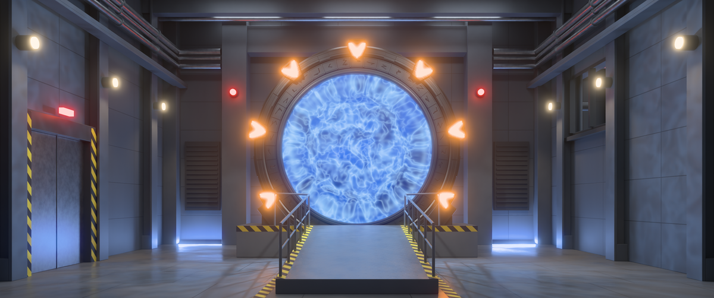

# Stargate SG-1 — an Omarchy theme



Stargate Command for [Omarchy](https://omarchy.org): you are standing on the
gate-room floor at the foot of the ramp, and the gate keeps dialing out.

- **Gate-room wallpapers** (`backgrounds/`). `1-gate.webp` is the default:
  a still of the gate with all seven chevrons lit and the wormhole open.
  `gate-loop.mp4` is the gate dialing out, a seamless 53 s video loop that
  Omarchy plays as a video background. The glyph ring spins back and forth,
  and the top chevron engages on each of seven symbols, lighting the
  chevrons in SG-1 order (1–3 down the right, 4–6 up the left, 7 at the
  top). The kawoosh blows out of the ring and falls back into a rippling
  event horizon that throws caustics over the room. The iris spirals shut
  over the live wormhole, holds, and reopens. The wormhole then disengages
  and the chevrons go dark. Both were rendered in Blender Cycles from a
  procedural scene.
- **Shell styling**: blue-black console panels with a blue→amber gradient
  frame and chevron-amber selection, across popups, menus, launcher,
  notifications and the lock screen. Window borders go from event-horizon
  blue to chevron orange.
- **Sounds** (`sounds/`, synthesized from sines and filtered noise, nothing
  sampled from the show): the gate dial, a chevron lock, a DHD press, the
  kawoosh and the shutdown. The extras below play them.

## Install

```bash
omarchy theme install https://github.com/vwillcox/omarchy-stargate-sg1-theme
```

For the animated gate, cycle to it with `omarchy theme bg next` or pick
`gate-loop.mp4` in the background switcher.

## Extras

The SGC bar is a dialing-computer console whose gate-status readout and
chevrons follow the gate on the wallpaper. It lives in its own repository,
[omarchy-stargate-sg1-extras](https://github.com/vwillcox/omarchy-stargate-sg1-extras),
with the gate dial that plays when the theme is applied and the scripts that
rendered the wallpapers and sounds. They're optional, and you install them
yourself.

## Uninstall

```bash
omarchy theme remove stargate-sg1
```

## License and credits

The theme (wallpaper video and still, sounds) is MIT licensed; see
`LICENSE`.

Stargate SG-1 is a trademark of MGM. This is a non-commercial fan theme, not
affiliated with or endorsed by MGM. The gate, its glyphs, the room and the
sounds were all made from scratch for this theme; nothing is taken from the
show.
